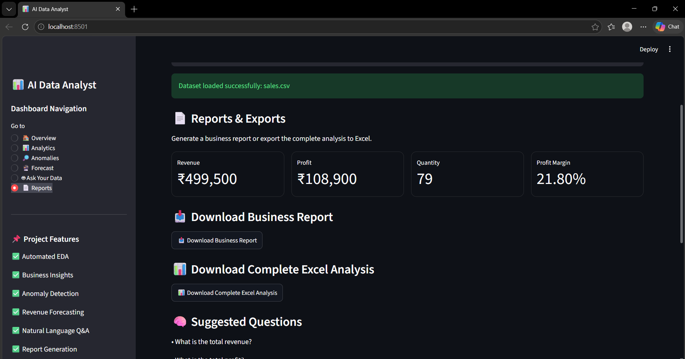
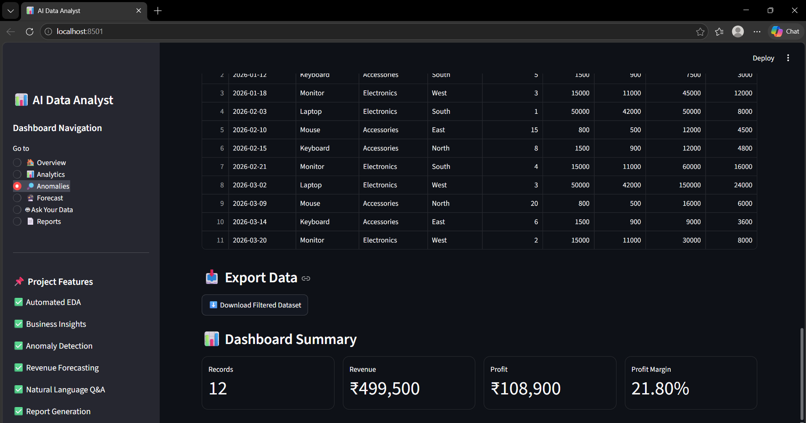
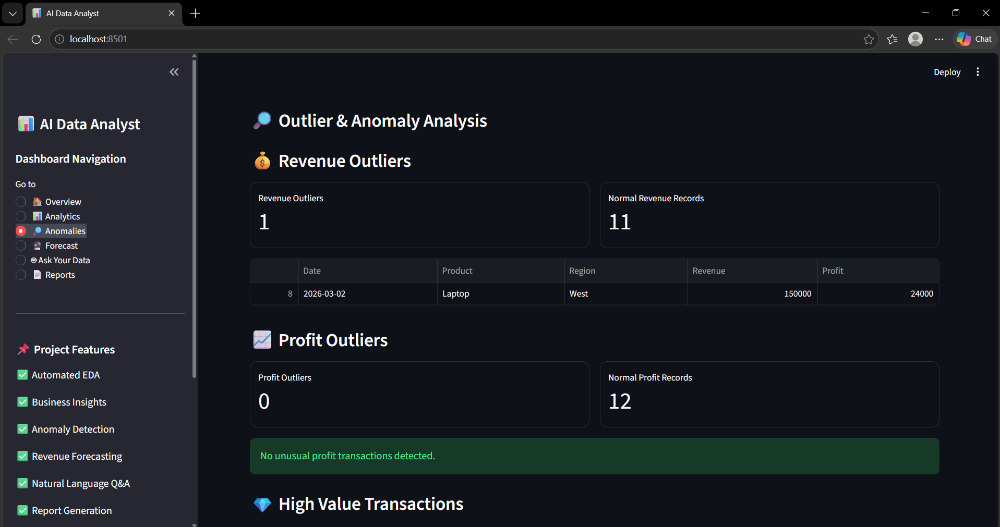
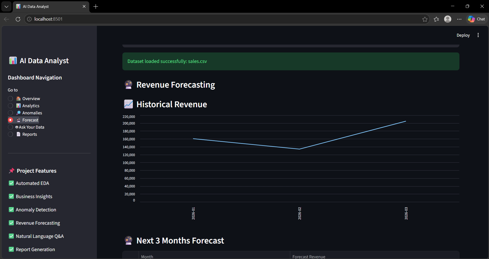
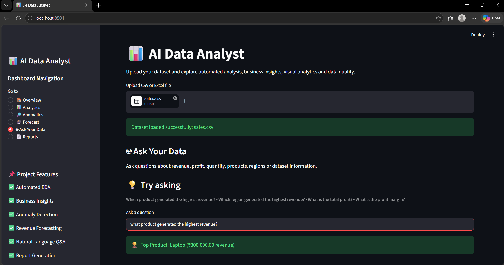
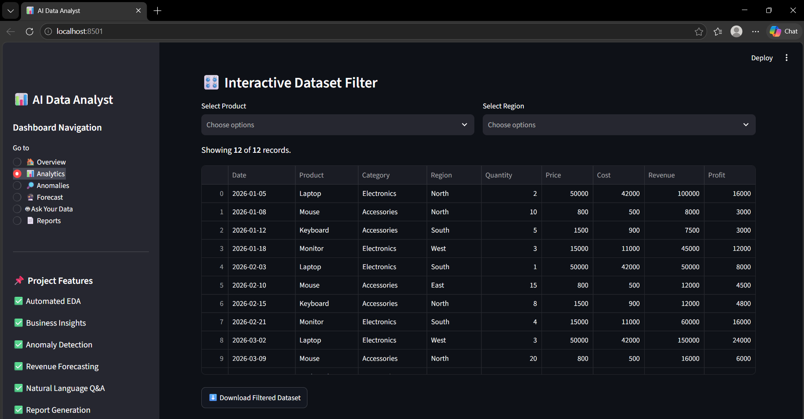

# 📊 AI Data Analyst

An AI-powered data analysis dashboard that allows users to upload business datasets and automatically explore, analyze, visualize, and understand their data.

The application combines traditional data analytics with AI-assisted natural-language querying to provide business insights without requiring users to manually write complex analysis code.

---

## 🚀 Project Overview

**AI Data Analyst** is a Python-based analytics application designed to transform raw business data into meaningful insights.

Users can upload CSV or Excel datasets and interact with the data through an interactive dashboard.

The application provides:

- Automated business analytics
- Data quality assessment
- Interactive visualizations
- Outlier and anomaly detection
- Revenue forecasting
- Product and regional analysis
- Business alerts
- Natural-language data questions
- Automated business reports
- CSV and Excel exports

The project was developed as a portfolio-level **B.Tech AI/ML project** with a focus on practical data analytics and intelligent automation.

---

## ✨ Key Features

### 🏠 Overview Dashboard

Provides a quick summary of the uploaded dataset including:

- Total Revenue
- Total Profit
- Average Revenue
- Average Profit
- Total Quantity
- Average Price
- Profit Margin
- Top-performing Product
- Top-performing Region
- Dataset information

---

### 📊 Analytics

The analytics section provides detailed business analysis through:

- Revenue analysis
- Profit analysis
- Product performance
- Regional performance
- Category analysis
- Revenue contribution
- Date-based analysis
- Business performance metrics
- Interactive charts

---

### 🔎 Anomaly Detection

The application automatically identifies unusual data points using statistical analysis.

It helps detect:

- Revenue outliers
- Profit outliers
- High-value transactions
- Unusual business patterns

This allows users to investigate potentially important transactions or patterns in their dataset.

---

### 🔮 Revenue Forecasting

The project includes a revenue forecasting module.

It:

1. Processes date-based revenue data
2. Aggregates revenue over time
3. Builds a forecasting model when sufficient historical data is available
4. Generates future revenue predictions
5. Visualizes historical and forecasted revenue
6. Provides automated forecast-related insights

---

### 🤖 Ask Your Data

Users can ask questions about their uploaded dataset using natural language.

Examples:

```text
What is the total revenue?

Which product generated the highest revenue?

Which region generated the highest revenue?

What is the total profit?

What are the average sales?

Show me the dataset information.

Are there any missing values?

Are there duplicate rows?

Give me the business summary.


## 👨‍💻 Author

**Akshit Sharma**

B.Tech — Artificial Intelligence & Machine Learning
---

## 📷 Dashboard Preview

### 🏠 Overview



---

### 📊 Analytics



---

### 🔎 Anomaly Detection



---

### 🔮 Revenue Forecast



---

### 🤖 Ask Your Data



---

### 📄 Business Reports

